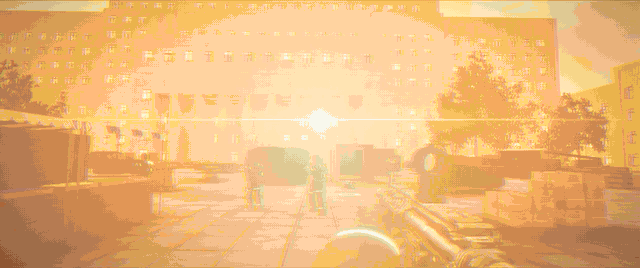

<div align="center">



# WARSAW DOWNTOWN

**Six players. One city. Zero allies.**
A free-for-all shooter in the browser. No download. No mercy.

</div>

---

## The game

- **Free-for-all, 2–6 players**, first to 25 kills takes the city. Fill the lobby with bots (Easy → Hard) or hunt your friends.
- **Friend rooms by link**: create a room, share the URL, and your friends drop straight in. No accounts, no install.
- **The Market**: close-quarters fighting through stall rows, containers and wrecks under the Palace tower in near-future Warsaw, in sun, dusk or rain.
- **Arsenal**: AR-7 rifle, Iskra smart SMG (bending rounds), KS-9 Cewka coilgun (hold to charge), SR-8 Sokół marksman rifle, M-12 Grom shotgun, ŁUK-3 arc rifle (energy, no reloads, watch the heat), sidearm, and a knife with combos and a timed parry.
- **Movement**: sprint, slide, vault, prone. Plus a secret.
- **Gadgets**: frag and smoke grenades, recon drone, jammer, radar uplinks.
- **Built to feel fair**: server-authoritative netcode with client prediction, lag-compensated hits with a per-player rewind cap, spawn protection, and a kill cam.

## Run it

```bash
pnpm install
pnpm dev          # client http://localhost:5173 + game server :2567
pnpm build && NODE_ENV=production GAME_PORT=2567 pnpm start   # one server: client + game
```

To play with friends over the internet, see [docs/HOSTING.md](docs/HOSTING.md) (Docker, Render, Fly.io or a VPS).

Needs Node ≥ 22 and pnpm 10. `pnpm check` runs typecheck, lint, format and the test suite.

## Tech

three.js (WebGL2) client · Colyseus 0.18 authoritative server · a shared deterministic 60 Hz simulation on Rapier, run by both sides · baked lightmaps · CC0 / CC-BY assets (see [ASSETS.md](ASSETS.md)).
Architecture: [docs/ARCHITECTURE.md](docs/ARCHITECTURE.md) · design: [docs/DESIGN.md](docs/DESIGN.md).

## Licence

Code is [MIT](LICENSE). Original game art and docs are [CC BY 4.0](LICENSES/CC-BY-4.0.txt), third-party assets keep their own licences ([ASSETS.md](ASSETS.md)), the OpenStreetMap-derived map data is [ODbL 1.0](LICENSES/ODbL-1.0.txt), and the name and the trailer are all rights reserved. Details: [LICENSING.md](LICENSING.md).

<sub>Built with Claude Code · Opus 5.5. Map base layer © OpenStreetMap contributors.</sub>
